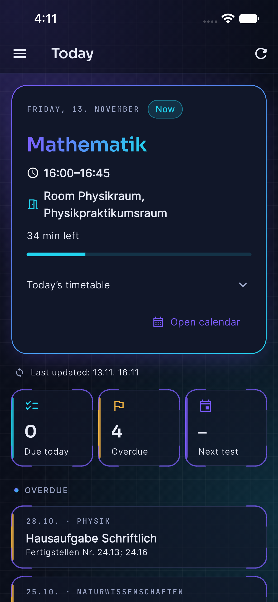

# Register — open and run in Xcode

1. Open **Register.xcodeproj**.
2. Select the **Register** scheme and your **iPhone, iPad, or simulator**.
3. Press **⌘R**.



No Flutter installation, CocoaPods installation, package download, or terminal
setup is required. The app, Flutter runtime, native plugins, fonts, and assets
are bundled locally. Keep the complete folder together; the project references
its `Frameworks`, `App`, and `Debugging` folders by relative paths.

For a physical iPhone, select **Register → Signing & Capabilities → Team** and
choose your Apple development team, then select the connected iPhone and Run.
The app now uses the unique identifier `app.register.personal.r9457c4543606d986`.
Xcode has created its development profile and signed a Release device build with
your selected team. **Run uses Release by default**, without a debugger. After
installing it once with Xcode, open the app directly from the phone's home screen;
the Mac and Xcode are not needed to launch it. Use **Product → Archive** for
distribution builds.

## Today and languages

The app opens on **Today**: your current or next teaching period, time, room,
countdown, and a compact overview of tasks and tests. Expand the timetable to see
the whole day. Tracked, unfinished tasks appear under Overdue; completed, deleted,
and untrackable past school entries are excluded. Moved tasks use their new date.

English, Italian, and German are included. The app follows your device language
by default, with a language picker on the sign-in screen and in Settings. Your
choice survives a restart. School-provided names, assignments, and messages keep
their original text.

## Home Screen widgets

Touch and hold the iPhone Home Screen, tap **Edit / + → Add Widget**, search for
**Register**, and choose **Next lesson** or **Deadlines**. Both have small and
medium sizes. Tapping a widget opens Today or the task list, including when the
app was closed.

Widgets show the schedule and pending deadlines saved by Register. Open or
refresh Register to fetch changes from school; the widget extension makes no
school-network requests. Known lesson boundaries and midnight changes are
scheduled locally with WidgetKit. iOS controls when it renders and reloads them.
Data older than a day is marked as saved data.

Widget sharing can be disabled in Settings. It also respects the app’s local
saving setting and clears its snapshot on sign-out. The app and extension share
`group.app.register.personal.r9457c4543606d986`; Xcode has successfully provisioned
and signed both with the selected development team.

Demo: school **Vinzentinum**, username **demo-user-6540**, any password.

## Apple Calendar export

Open **Kalender**, select a week, and tap the export icon at the top right.
Choose lessons, tests, and/or tasks, then choose the destination calendar in
Apple's calendar picker. Allow Calendar access when prompted. On iOS 17 or later
the app requests permission to add events, without reading existing events.

Lesson times retain the school's Europe/Rome time zone and actual teaching
breaks. Tests and tasks are exported as all-day deadlines. Completed tasks and
entries without usable lesson times are excluded. Duplicate prevention remembers
items exported by this installation; turn it off to explicitly export them again.
This is a one-time copy, not an automatically updated calendar subscription.

## Clone from GitHub

Clone this repository normally, then open `Register.xcodeproj`. The runtime
frameworks are included as ordinary Git files: no Git LFS, Flutter, or CocoaPods
setup is needed to run the app. Optional large Flutter crash-symbol files are
compressed in `DeveloperTools/Symbols/`; they are not needed to build or run.

The project targets iOS 15 or later and was verified with Xcode 27.2. Xcode must
have an iOS simulator runtime installed to run a simulator. Device signing
credentials are intentionally not included.

## Source and changes

The native launch code is in `App/`. The original Flutter application source,
including the iOS fixes and offline fonts, is in `Source/Flutter/`.

The Flutter UI is supplied as precompiled XCFrameworks so the app can run from
Xcode without installing Flutter. Swift/Objective-C launch-code changes build
directly in Xcode. After changing Dart source, developers with Flutter 3.47.5
and CocoaPods can run `bash DeveloperTools/RebuildFrameworks.sh` to update the
bundled application frameworks, then return to Xcode. Adding native plugin
dependencies also requires updating the project's framework references.

Third-party licenses are in `Licenses/`, `Source/Flutter/LICENSE.txt`, the font
asset directory, and the app's bundled notices. The app remains GPL-3.0.

## Launch test

Press **⌘U** to run the Xcode UI tests. They check application launch and, on a
simulator, language switching, widget links, demo Calendar export, duplicate
prevention, and Home Screen widget launch. Use a disposable
simulator: the export test writes demo events to its calendar. The app also
passed all 89 Flutter unit/widget tests. See `VERIFICATION.md` for checks and
remaining physical-device limits.

Xcode automatically selects the bundled Debug Flutter runtime for simulators;
physical-device Run and Archive use the Release runtime. The simulator can be
launched without a debugger as well. The native widget model checks can be run
with Apple’s Swift compiler:

```sh
swiftc Shared/WidgetSnapshot.swift UITests/WidgetModelChecks.swift -o /tmp/register-widget-checks
/tmp/register-widget-checks
```
